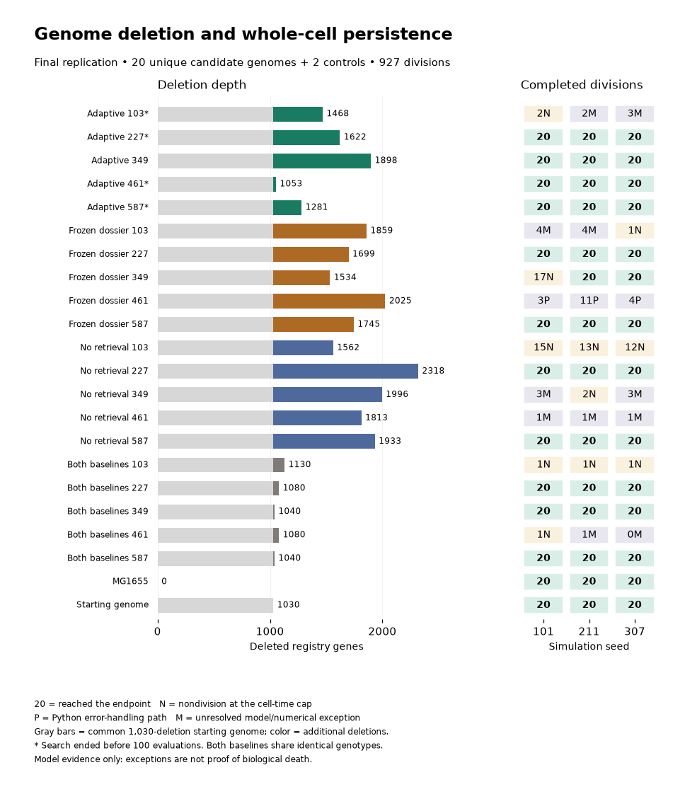

# Experiment ledger

Start with the [9 November replication results](comparisons/search-replication-20261109.json), [frozen methods](../methods/20261109/README.md), and [study record](records/search-replication-20261109.json). The [complete ledger index](index.json) links every study to exact inputs, results, W&B artifacts, private S3 objects, SHA256 checksums, failed attempts, and cleanup evidence.

## Search replication: 9–10 November 2026

Five methods × five fresh searches started from the same 1,030-deletion genome. Each had a 100-candidate ceiling and one nominee frozen before whole-cell validation. Identical nominees were deduplicated: 20 candidate genomes plus two controls, each simulated for up to 20 generations using three fixed seeds. All science ran on remote Linux.

| Method | Nominees reaching 20 generations in all 3 seeds | Total registry deletions in successful nominees | Searches using all 100 evaluations |
| --- | ---: | --- | ---: |
| Adaptive literature | 4/5 | 1,053; 1,281; 1,622; 1,898 | 1/5 |
| Frozen dossier | 2/5 | 1,699; 1,745 | 5/5 |
| No retrieval | 2/5 | 1,933; 2,318 | 5/5 |
| Greedy block | 3/5 | 1,040; 1,040; 1,080 | 5/5 |
| Randomized block | 3/5 | 1,040; 1,040; 1,080 | 5/5 |

There were **927 divisions; 41/66 lineages reached 20 generations**. Eleven stopped without division at the fixed 10,800-second cell cap; 14 stopped with model/software exceptions. Three exceptions exposed a Python error-handling path in the equilibrium solver; 11 remain unresolved model/numerical failures. These categories do not establish genotype-caused death. Both controls passed in all three seeds.

The two baseline methods selected the same five genotypes. Their shared trajectories are not independent validation evidence. Four adaptive searches ended early (three errors, one model-budget stop), so the arms had equal assigned ceilings but unequal realized evaluation budgets. The summary retains every assigned search and provides registry, current-functional, and shared-functional deletion percentages using the frozen mapping. Simulation seeds are repeated trajectories, not independent searches. Five searches per method support an exploratory comparison; these data do not establish a retrieval benefit or a universal agent survival advantage.

The baseline audit found 998/1,000 evaluations used the coarse 100- or 50-gene block settings, with 12 growth-gate-passing proposals. A [separate deeper-baseline draft](../methods/20261109/baseline-depth-extension-draft.json) proposes continuing the saved graphs to a fixed 2,000-evaluation ceiling and freezing nominees at predefined deletion thresholds. It is **not authorized or launched**. Survival, failure, and inability to reach a threshold are all informative; nominees must never be chosen for anticipated failure.

Use the [study record](records/search-replication-20261109.json) → `final_results` and `data_preservation` for the compact analysis, three worker archives, aggregate archive, catalog, independent member audits, and exact W&B versions. Full graphs, histories, daughter states, failed attempts, and source input identities remain in private S3. Git contains screened source and compact results only. The old operational `coordinator/status.json` ended with a stale running label; the closed final catalog is authoritative.

## Historical comparison: 6 November 2026

| Search condition | Independent genomes | Registry genes deleted | Current functional genes deleted | 20-generation lineages |
| --- | ---: | ---: | ---: | ---: |
| Agent, no retrieval | 1 | 1,919/4,290 (44.73%) | 789/1,915 (41.20%) | 2/3; third reached 14 then model error |
| Agent, frozen dossier | 1 | 1,765/4,290 (41.14%) | 666/1,915 (34.78%) | 3/3 |
| Agent, adaptive literature | 1 | 1,823/4,290 (42.49%) | 664/1,915 (34.67%) | 3/3 |
| Randomized block baseline | 5 | See exact per-genome comparison | See exact per-genome comparison | 0/15 |
| Greedy block baseline | 5 | See exact per-genome comparison | See exact per-genome comparison | 0/15 |
| MG1655 and common starting-genome controls | 2 | 0 and 1,030 | 0 and 341 | 6/6 in each validation study |

All ten baseline genomes divided once in all three simulation seeds. Twenty-nine trajectories then reached the fixed 10,800-second cell limit without another division. One greedy-baseline trajectory raised `InvalidBoundaryError`; retain this as a model exception. The eight successful agent trajectories reached 20 divisions. The remaining agent trajectory also ended with a model exception.

These are expression-knockout model outcomes in aerobic M9 glucose, not physical DNA shortening or laboratory viability. The current functional denominator follows the recorded five-process rule; it is not an exhaustive census of every dependency in modern vEcoli. The comparison JSON also reports the exact 1,197-gene panel shared with the published reference.

Each agent condition has one search seed and an inherited search graph. Each baseline method has five search seeds, starting from the common 1,030-deletion genome. Baselines consumed 500 new evaluated states per run; the agent searches stopped on model budgets. Simulation seeds are repeated trajectories of the same genome. These runs do not establish a matched-budget, statistically replicated method advantage or an independent benefit from literature retrieval. Both validation studies used the same strict numerical fallback policy; assisted generations and exceptions remain recorded.

## Records and data locations

- [Agent search continuation](records/literature-ablation-kimi-continuation-20261106.json) → [agent vEcoli validation](records/vecoli-kimi-continuation-20gen-3seed-20261106.json).
- [Ten baseline searches](records/deletion-baselines-20261106.json) → [baseline vEcoli validation](records/vecoli-deletion-baselines-20gen-3seed-20261106.json).
- [Methods and frozen source files](../methods/20261106/README.md).
- [S3 verification receipt](verification/backup-check-20261107.json).

Git contains the source and compact records. Private S3 contains full graphs, trajectories, daughter states, inputs, detailed analyses, and immutable archive indexes. W&B artifact versions and checksums are recorded alongside S3 references. Failed attempts remain preserved. The dedicated workers and their disks were removed after independent backup verification; shared compute remains untouched.

The full working `experiments.json` remains available locally and in private S3. It is excluded from Git to avoid a growing monolithic data file. `index.json` plus `records/*.json` reconstructs that ledger without discarding fields or historical entries. To reconstruct it offline into a new file, run `python scripts/export_experiment_ledger.py restore --output /path/to/new-ledger.json`. The restore refuses to overwrite an existing file and checks every record's size and SHA256.

Rebuild the comparison from the verified compact final analyses with `python scripts/build_agent_baseline_comparison.py --output experiments/comparisons/agent-baselines-20261106.json`. This reads existing metadata only; it launches no science or API calls.
